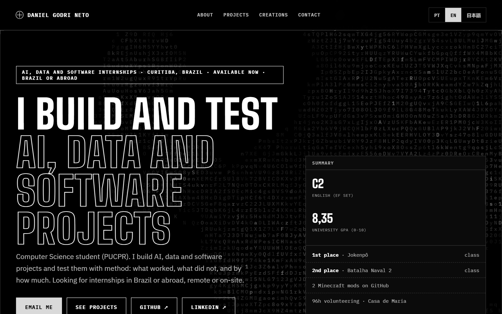
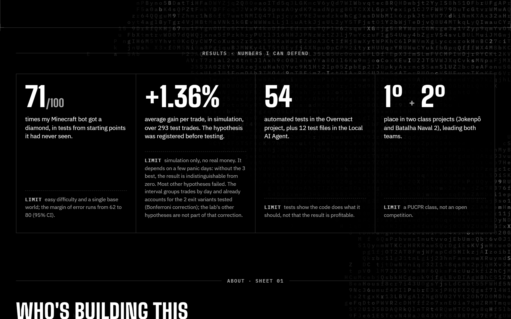
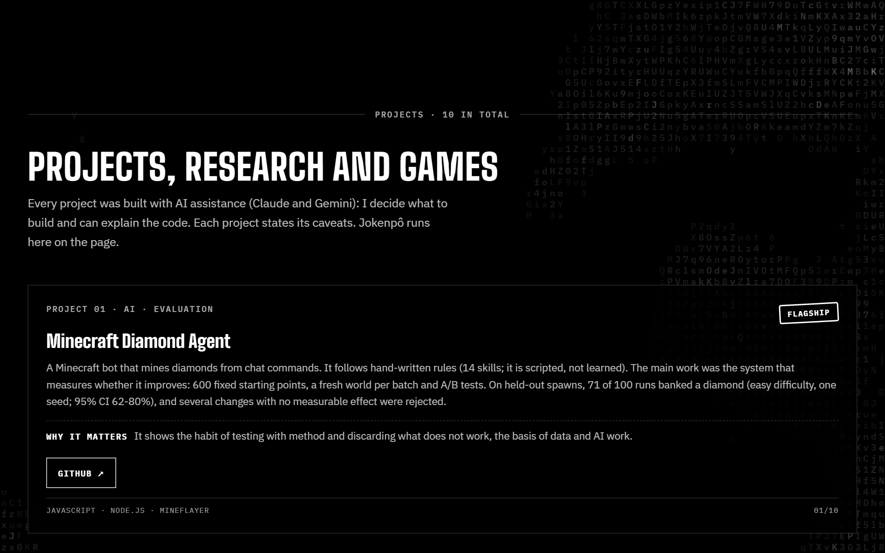
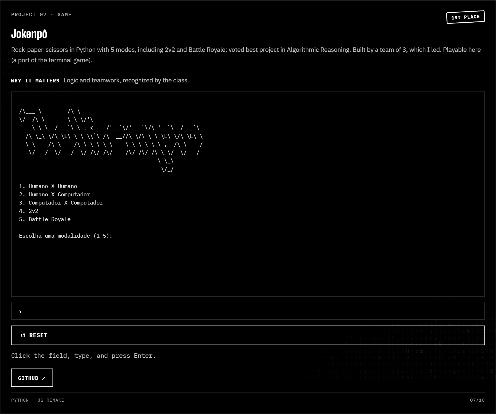
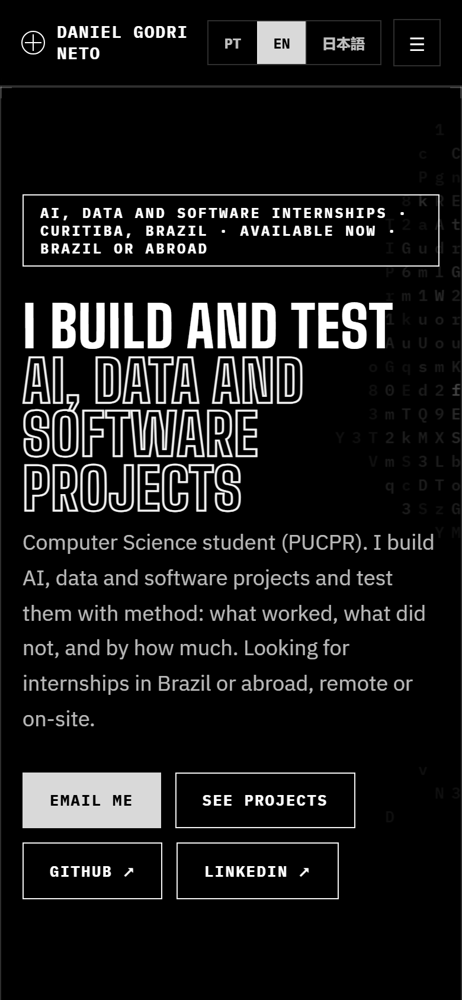

<div align="center">

# Daniel Godri Neto

**I build and test AI, data and software projects.**
Computer Science student at PUCPR, Curitiba. Looking for internships in Brazil or abroad.

[**Live site**](https://resume-portifolio-vagas-ebd126.gitlab.io/) · [GitHub](https://github.com/DanielGodriNeto) · [LinkedIn](https://www.linkedin.com/in/danielgodrineto/) · [Email](mailto:godrineto@gmail.com)



</div>

## What this is

A trilingual (PT / EN / 日本語) portfolio built for internship applications. Every project states what worked, what did not, and its limits. It is plain HTML, CSS and JavaScript: no framework, no build step.

## Numbers, with their limits



| Result | Limit |
|---|---|
| 71 of 100 runs of my Minecraft bot got a diamond, from starting points it had never seen | Easy difficulty, one base world, 95% CI 62-80% |
| +1.36% average gain per trade over 293 test trades, hypothesis registered before testing | Simulation only; without the 3 best days it is indistinguishable from zero |
| 54 automated tests in Overreact, plus 12 test files in the Local AI Agent | Tests show the code does what it should, not that it is profitable |
| 1st and 2nd place in two class projects, leading both teams | A PUCPR class, not an open competition |

## Projects



| Project | What it is | Repo |
|---|---|---|
| Minecraft Diamond Agent | Scripted bot (14 skills) plus an A/B evaluation system | [minecraft-agent](https://github.com/DanielGodriNeto/minecraft-agent) |
| Overreact | Pre-registered trading-hypothesis lab, Bonferroni over 2 variants, bootstrap by day | [overreact](https://github.com/DanielGodriNeto/overreact) |
| Local AI Agent | Local voice agent for Windows, with tests in CI | [local-ai-agent](https://github.com/DanielGodriNeto/local-ai-agent) |
| CS2 Trade-Up Scanner | Read-only price scanner, in-browser ML teaching demo | [cs2-trade-calculator](https://github.com/DanielGodriNeto/cs2-trade-calculator) |
| Godri-Culling | GPU-driven terrain culling add-on for Sodium | [Godri-Culling](https://github.com/DanielGodriNeto/Godri-Culling) |
| Lead-generation pipeline | Demo sites for local businesses, with a simulation-first safety lock | private code |
| Jokenpô | Rock-paper-scissors, 5 modes, playable on the page | [PjBL-RA1-Jokenpo](https://github.com/DanielGodriNeto/PjBL-RA1-Jokenpo) |

All projects were built with AI assistance (Claude and Gemini): I decide what to build and can explain the code.

### Jokenpô runs in the page



The rules live in `assets/js/jokenpo-rules.js` and are shared by the page and the Node test.

## Details

- Language is picked from the browser on the first visit; the PT / EN / 日本語 toggle exposes `aria-pressed`.
- ASCII canvas background, count-up numbers and a text-decode effect, all with a reduced-motion fallback and a screen-reader copy.
- Responsive down to phone width.



## Run locally

```bash
python -m http.server 8000
```

Or `python .claude/serve.py` for a no-cache server on port 8080.

Check the game logic:

```bash
node tests/jokenpo-logic.test.js
```

## Layout

```
index.html              the site
assets/                 css, js, images
tools/ml-sandbox/       in-page gradient-boosting demo
tests/                  Jokenpô rules check
docs/img/               screenshots used here
```
